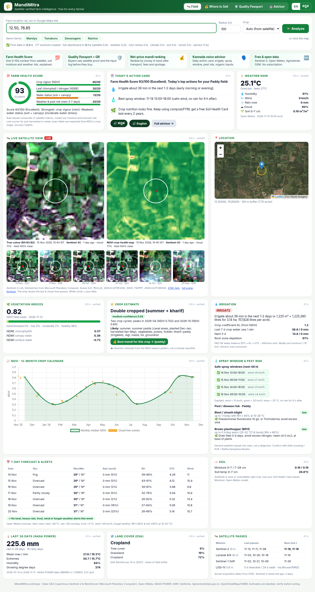
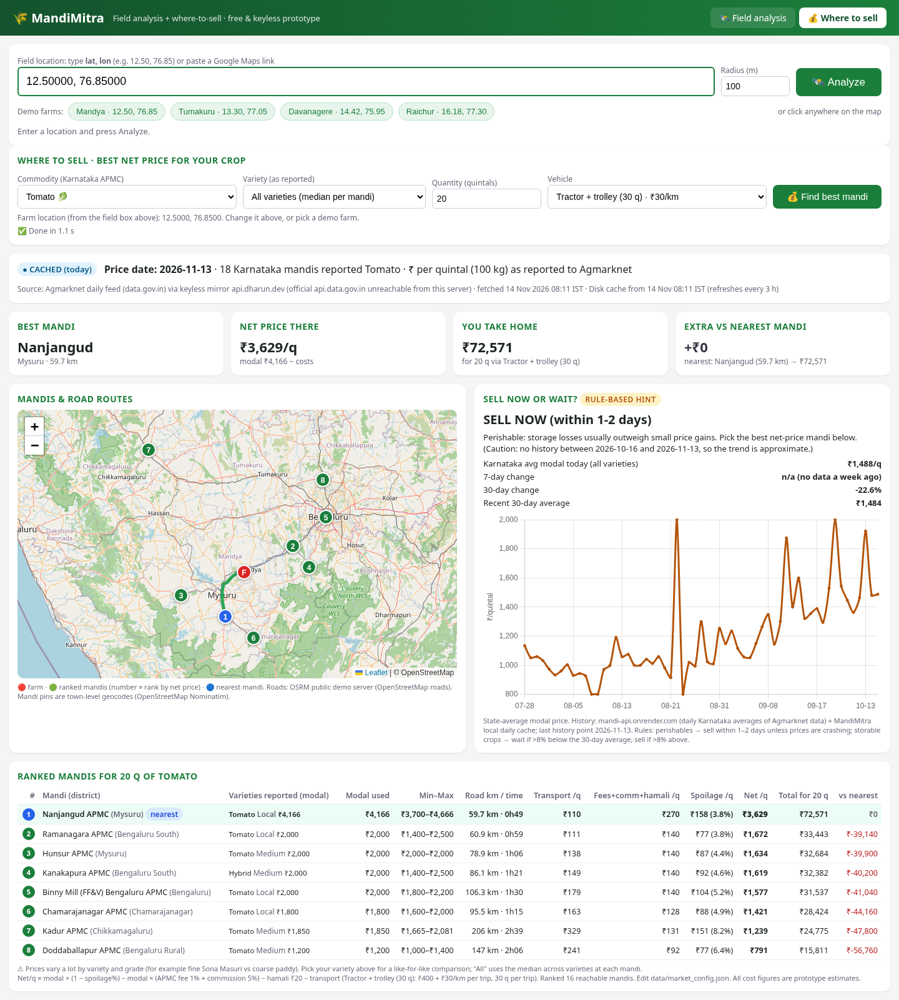

# MandiMitra — satellite-verified farm intelligence for every Karnataka farmer (v0.3, judge demo)

Free, keyless, Kannada-first dashboard: type a lat/long (or paste a Google Maps link) and get a live
Sentinel-2 view of *that* field, a Farm Health Score, a daily bilingual action card with voice, spray/pest
alerts, a net-price mandi ranking, and a shareable **Farm Quality Passport** with a QR code for buyers.



## What's new in v0.3 (judge build)
* **Fast + progressive**: 7 independent API calls fire in parallel; each card renders as soon as its data
  arrives (skeleton placeholders, per-card timing badge, status line "First data in X s · full dashboard in Y s").
  Server-side single-flight memo cache (app/memo.py) + startup pre-warm of the 4 demo farms.
* **Tabs**: Field | Where to Sell | Quality Passport | Advisor, **EN / ಕನ್ನಡ** toggle, mobile responsive.
* **Farm Health Score 0–100** (app/advisor.py): NDVI vigour 40 + NDRE chlorophyll 20 + water status 20
  (FAO-56 root-zone depletion + NDMI) + weather/pest risk 20, with a plain-language + Kannada explanation.
* **Daily action card** (Kannada + English) with **🔊 Listen** (Web Speech, kn-IN → en-IN fallback).
  Optional LLM polish if `GROQ_API_KEY` or `GEMINI_API_KEY` is set; rule-based templates otherwise.
* **Spray windows + pest risk** from Open-Meteo hourly data (wind < 10 km/h, gusts < 20, T < 32 °C, no rain
  for 6 h; crop-specific fungal / sucking pest / BPH / fall-armyworm rules with organic actions).
* **Farm Quality Passport** (`/passport/<id>`, app/passport.py, SQLite `data/mandimitra.db`): live RGB + NDVI
  with scene IDs and dates, 12-month NDVI trend, crop pattern, farmer's self-declared chemical/organic input log
  (optional bill photo), organic score, soil, pest risk, QR code, WhatsApp share, print to PDF.
* **Government schemes quick-check**: PM-KISAN, PMFBY, KCC, PKVY, PM-KUSUM, Soil Health Card — indicative only,
  links to official portals.
* Field crop → "Sell this crop" jumps straight to the net-price mandi ranking.

## Measured load times (box, 14 Nov 2026 IST)
| Case | First data | Full dashboard |
|---|---|---|
| Pre-warmed demo farm (any of 4 presets) | 0.0–0.1 s | 0.1 s |
| Brand-new location (cold) | 0.1 s (weather) | 5.4 s (satellite ≈3 s, SoilGrids ≈5 s cap) |
Pre-warm of all 4 presets at startup ≈ 18 s in background. Screenshots + timings: `demo_shots/judge_*.png`, `demo_shots/timings.json`.

## New API endpoints
`/api/weather` `/api/sat/latest` `/api/sat/series` `/api/climate` `/api/soil` `/api/revisit`
`/api/summary?crop=` (score, action card, spray, pest) · `/api/schemes` · `GET/POST /api/farms` ·
`POST /api/farms/{id}/logs` (multipart, bill photo ≤ 5 MB) · `/api/passport/{id}` · `/passport/{id}` ·
`/api/qr/{id}.png` · `/health` (pre-warm status). Older `/analyze`, `/market`, `/commodities`, `/resolve` still work.
All take `lat`, `lon`, `r` (metres). Every response carries `_meta` (compute_s, cached, served_s).

## Environment variables (all optional)
| Var | Effect |
|---|---|
| `GROQ_API_KEY` / `GEMINI_API_KEY` | LLM-polished advisor text (else rule-based) |
| `PUBLIC_BASE_URL` | Base URL encoded in passport QR codes (else request host, e.g. localhost) |
| `NO_PREWARM=1` | Skip startup pre-warm |
| `DATA_GOV_IN_KEY` | Use official data.gov.in key for Agmarknet (mirror used otherwise) |

Presenting? See **DEMO_SCRIPT.md** (2-minute flow, talking points, competitor table).

---

# Earlier documentation (v0.2 field + market modules)

Give a latitude, longitude and field radius and get a farm report built only from **free, keyless** sources:
satellite crop health (NDVI / NDRE / NDMI / NDWI), a 12-month NDVI curve, an estimated crop / land use,
weather, soil moisture, irrigation advice, alerts, 30-day climate and satellite pass dates.


## Live-imagery demo (what proves it's real)
- Type `lat, lon` in the big box, paste a Google Maps link (`…/@lat,lon,15z`, `?q=lat,lon`, `!3d…!4d…`, or a short `maps.app.goo.gl` link, which the server expands through `/resolve`), or click the map.
- Preset demo farms (all ESA WorldCover cropland): **Mandya 12.50, 76.85 · Tumakuru 13.30, 77.05 · Davanagere 14.42, 75.95 · Raichur 16.18, 77.30**.
- **Live satellite view card:** the latest cloud-free Sentinel-2 **true-colour RGB** (B4/B3/B2 reflectance, 2–98% stretch) next to the **NDVI** map, field circle outlined. Each image is captioned with acquisition date and time in IST, satellite (S2A/S2B/S2C), MGRS tile(s), tile cloud %, field clear %, days ago and scene ID.
- Links to the source: the STAC item JSON, the full-scene preview PNG, and Planetary Computer Explorer at the pin.
- **Strip of the last 6 cloud-free passes** (RGB thumbnails with date, satellite, days ago). Click one for the full scene.
- Fields on a tile edge are mosaicked from the neighbouring tiles of the same pass, so there are no black gaps.
- Extra screenshots: `screenshot_live_view.png`, `demo_shots/*.png`.

## Where to sell (mandi price recommender) — tab "💰 Where to sell"


Inputs: the farm location (same box as the field analysis), commodity (26 Karnataka crops), variety (filled from that day's reports), quantity in quintals, vehicle.
API: `GET /market?lat=12.50&lon=76.85&commodity=tomato&qty=20&vehicle=tractor[&variety=Paddy%20Medium]`, plus `GET /commodities` for the commodity and vehicle lists.

**Price data, in the order the server tries it (the status is shown as a badge with the price date and source):**
1. **Official data.gov.in OGD API** (resource `9ef84268-d588-465a-a308-a864a43d0070`), key from env `DATA_GOV_IN_KEY` or the public sample key → `live`.
2. **Keyless mirror of the same feed**, `api.dharun.dev/v1/mandi` (it re-reads data.gov.in every 3 h) → `live (via mirror)`. From this box the official API fails at the TLS handshake, so the mirror is what's used today.
3. **Disk cache**, `data/cache/prices_<crop>_<date>.json`, refreshed every 3 h; an older cache file is used if all live sources fail → `cached`.
4. **Bundled snapshot**, `data/snapshot_karnataka_2026-11-13.json`: 346 REAL Agmarknet rows (prices dated 2026-11-13) saved on 14 Nov 2026 → `fallback`, labelled "NOT today's". Nothing is fabricated. Refresh it with `python tools/build_snapshot.py --refresh`.

**Mandi locations:** `data/mandi_geo.json`, built with OpenStreetMap Nominatim (1 request/second, cached). Of 76 Karnataka APMCs, 75 resolve to their town and one (Santhesargur) to its district centroid. New mandis are geocoded on first use.
**Road distance and time:** one OSRM public `table` request, plus route lines for the top 5 and the nearest mandi. If OSRM fails, it falls back to straight-line distance × 1.3 at 40 km/h.
**Net price per quintal** = modal × (1 − spoilage%) − modal × (APMC fee% + commission%) − hamali − transport per quintal.
- Transport per trip = fixed + ₹/km × road km; trips = ceil(quantity / vehicle capacity).
- Spoilage applies to perishables (tomato, beans and other vegetables: 2% + 3% per 100 km, capped at 20%) and semi-perishables (onion, potato, coconut: 0.5% + 0.5% per 100 km).
- Every assumption lives in `data/market_config.json`. These are **prototype estimates, not official rates**.

**Trend and "sell now or wait":** the Karnataka average modal price per day comes from `mandi-api.onrender.com/v1/prices/history` (keyless) and MandiMitra's own daily cache, which grows by one point per day.
- The page shows the 7-day and 30-day change, the 30-day mean and a chart. Gaps in the history are called out.
- Rule-based hint: perishables → sell within 1–2 days (and say so plainly if prices are crashing); storable crops → wait if more than 8% below the 30-day mean, sell if more than 8% above.

## Run

```bash
cd mandimitra
./run.sh                 # creates .venv + installs requirements on first run
# open http://localhost:8077
# or: http://localhost:8077/?lat=12.50&lon=76.85&rad=100&auto=1
```
Manual: `python3 -m venv .venv && . .venv/bin/activate && pip install -r requirements.txt && uvicorn app.main:app --port 8077`

Requires Python 3.10+ and internet. No API keys.

### API
`GET /analyze?lat=12.50&lon=76.85&radius=100` → JSON (radius 20–1000 m, default 100; `&nocache=1` to bypass the 30-min cache).
Takes ~10–20 s on first call. See `sample_output_mandya.json` for a real response.

Main JSON blocks: `field`, `crop_health` (latest clear scene, index stats, NDVI zones), `thumbnails` (base64 PNGs),
`ndvi_timeseries` (monthly medians + every clear scene), `crop_estimate`, `landcover`, `weather`, `irrigation`,
`alerts`, `climate_30d`, `soil_properties`, `revisit`, `thumbnails.scene` (date/IST time, satellite, scene id, links),
`recent_clear_scenes` (last 6 clear passes with RGB thumbnails). `GET /resolve?q=<lat, lon | Google Maps URL>` → `{lat, lon}`.

### Screenshot
`python shot.py [url] [out.png]` (Playwright + Chrome/Chromium; edit `executable_path` in `shot.py` or run `playwright install chromium`).

## How it works

| Feature | Source (keyless) | Method |
|---|---|---|
| Crop health now | Sentinel-2 L2A, Microsoft Planetary Computer STAC | Newest scene whose SCL cloud mask leaves ≥80 % of the field clear. Reads only the field window from cloud-optimised GeoTIFFs. NDVI=(B8−B4)/(B8+B4), NDRE=(B8−B5)/(B8+B5), NDMI=(B8−B11)/(B8+B11), NDWI=(B3−B8)/(B3+B8). Applies the −1000 offset for processing baseline ≥ 04.00. |
| NDVI time series | same | Up to 3 least-cloudy scenes per month; field mean of clear pixels; monthly median. |
| Crop / land use | NDVI curve + ESA WorldCover 2021 | Rule-based phenology: count greenness peaks and their season (kharif Jul–Nov, rabi Dec–Mar, summer Apr–Jun), long green spell (sugarcane-like), evergreen (plantation), never green (fallow/built-up), water. Confidence capped at 0.75. **Heuristic estimate, not a trained model.** |
| Thumbnails | Sentinel-2 TCI + B4/B8 | True colour + NDVI colour map, ±400 m window, field circle drawn. |
| Weather, soil moisture/temp, ET0 | Open-Meteo | Current conditions, 7-day forecast, 0–7 and 7–28 cm soil moisture and temperature. |
| Irrigation | Open-Meteo + NDVI | FAO-56: ETc = Kc·ET0, Kc = 1.25·NDVI+0.2; 7-day deficit = ΣETc − effective rain; also checks root-zone depletion against a generic loam. Output: irrigate / wait / not needed, depth in mm and litres. |
| Alerts | Open-Meteo forecast | Heat >38 °C, heavy rain >50 mm/day (moderate >20 mm), frost <4 °C, wind >40 km/h, fungal risk (RH max ≥90 % & min ≥60 % at 15–32 °C). |
| 30-day climate | NASA POWER | Rain, rainy days, temperatures, humidity, solar, growing degree days. |
| Soil texture/chemistry | ISRIC SoilGrids (optional) | pH, SOC, N, clay, sand at 0–5 cm. The service is often slow; the card says so when it times out. |
| Satellite passes | Planetary Computer STAC + static table | Actual recent Sentinel-2, Landsat 8/9 and Sentinel-1 dates over the point. Next pass = last pass per relative orbit + 5 d (S2), +8 d (Landsat), +12 d (S1). The revisit table includes LISS-IV (5 d steerable / 24 d nadir). |

## Files
```
app/main.py       FastAPI app, /analyze orchestration, cache
app/satellite.py  Sentinel-2 / WorldCover / Landsat / S1 via STAC, index stats, thumbnails
app/crop.py       rule-based crop / land-use heuristic
app/weather.py    Open-Meteo, irrigation balance, alerts, NASA POWER, SoilGrids
app/revisit.py    revisit table + next-pass estimate
app/market.py     where-to-sell: prices (OGD -> mirror -> cache -> snapshot), geocoding, OSRM, net-price ranking, trend/hint
data/market_config.json   vehicle rates, APMC fee, commission, hamali, spoilage (editable assumptions)
data/mandi_geo.json       cached mandi coordinates (Nominatim)
data/snapshot_karnataka_2026-11-13.json  real Agmarknet fallback snapshot
tools/build_snapshot.py   rebuild snapshot + geocode all mandis
static/index.html dashboard (Leaflet + Chart.js, CDN)
shot.py           headless screenshot
```

## Limitations
- Where to sell: Agmarknet prices are yesterday's reports (mandis upload through the day). Not every mandi reports every crop every day, and prices vary by variety and grade. Mandi pins are at the town centre, not the yard gate. Transport, fee, commission and spoilage figures are estimates. The history mirror has a gap from 16 Oct to 13 Nov 2026, so 7-day trends show as n/a until the local cache builds up.
- Crop type is a **guess from greenness timing**. Real crop ID needs ground-truth plots (e.g. Bhuvan/CROP survey points) and a trained model (Random Forest / LSTM on S1+S2).
- Monsoon clouds leave gaps (Jun–Sep). Sentinel-1 radar backscatter would fill them; it isn't used for indices yet.
- Soil moisture and temperature come from a ~10 km weather model, not the field. The irrigation advice assumes a generic loam soil.
- The field is a circle around the pin, not a real boundary. Next step: let the user draw a polygon.
- Satellites can't detect pesticide or chemical use; that has to come from farmer records.
- LISS-IV isn't in an open STAC, so it appears only in the revisit table.
- Public endpoints (Planetary Computer, Open-Meteo, POWER, SoilGrids) can be slow or rate-limited. Results are cached in memory for 30 min.

### v0.3 limitations
* Kannada strings are template-based — get a native speaker to review before public launch.
* LLM polish path is implemented but untested here (no key configured).
* Input logs are self-declared; satellites cannot detect chemical use. Passport says so explicitly.
* QR codes point to localhost unless `PUBLIC_BASE_URL` is set (use your ngrok/public URL for the demo).
* ISRIC SoilGrids is flaky; it's capped at ~5 s and shows "unavailable" rather than blocking.
* Scheme eligibility is indicative; pest rules are general weather-based guidance; crop pattern is heuristic.
* Mandi prices come from a keyless Agmarknet mirror (data.gov.in unreachable from this server) and are ~1 day old.
* Concurrency uses thread pools + single-flight memo (not asyncio/httpx); in-memory cache resets on restart.
